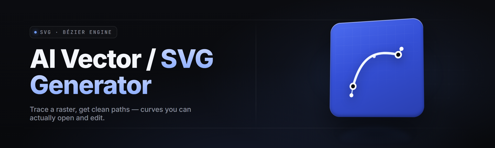

  
  
  

  

  
  
  

---

### **svg-vector-forge** — the AI vector / SVG generator for Windows

*Describe it in plain English. Get clean, editable, production-ready SVG out.*

---

## 🐞 Known Issues — Is anything broken right now?

| Issue | Fix |
| --- | --- |
| Very long prompts (>800 chars) on low-VRAM GPUs can stall the raster preview. | Lower **Render Preview** to `512px` in Settings, or hit **Vectorize Only** (skips the raster preview entirely). |
| Hand-drawn scribble imports with >4 overlapping strokes sometimes merge into one path. | Set **Stroke Split** to `Aggressive` under the Trace panel before importing. |
| Fonts not installed on Windows render as outlined shapes (expected — SVG has no font fallback). | Switch **Text Mode** to `Outline` so the shape is intentional, not accidental. |
| Exported SVG opens fine in browsers but shows nested `<g>` wrappers in Illustrator. | Enable **Flatten Groups** on export — collapses nested groups into a single deterministic tree. |
| First launch after a Windows feature update re-asks for the license key. | It reads `%APPDATA%\svg-vector-forge\license.dat`; if missing, re-enter once and it persists. |

> The blocker list is short on purpose. If you hit something not listed here, the in-app **Report** button attaches a redacted log you can paste into an issue.

---

## 🖥️ Compatibility — Does it work on my machine?

| Platform / Context | Status | Notes |
| --- | --- | --- |
| Windows 10 (21H2+) x64 | ✅ Full | DirectML acceleration on most GPUs. |
| Windows 11 x64 | ✅ Full | Recommended — best CPU scheduler behavior. |
| Windows on ARM | ⚠️ Partial | CPU-only inference; usable but slower raster preview. |
| NVIDIA (CUDA 12) | ✅ Opt-in | ~2.4× faster preview vs DirectML. |
| AMD (Vulkan/DirectML) | ✅ Full | Works out of the box, no extra driver step. |
| Intel Arc / Iris Xe | ✅ Full | XeSS not used; runs through DirectML. |
| Steam / Steam Deck (Proton) | ⚠️ Experimental | Runs under Proton 9, preview disabled. |
| InkScape / Illustrator / Figma import | ✅ Full | All standard SVG 1.1/2.0 output. |

---

## 📑 Table of Contents

1. [Known Issues](#-known-issues--is-anything-broken-right-now)
2. [Compatibility](#️-compatibility--does-it-work-on-my-machine)
3. [What is svg-vector-forge?](#-what-is-svg-vector-forge)
4. [Usage guidelines — Is it okay to ship the output?](#-usage-guidelines--is-it-okay-to-ship-the-output)
5. [Comparison — How is it different?](#-comparison--how-is-it-different)
6. [The Solution](#-the-solution)
7. [The Problem](#-the-problem)
8. [Installation](#️-installation--walk-hold-steps)
9. [Tips for best results](#-tips-for-best-results)
10. [Overview](#-overview)
11. [All modules status](#-all-modules-status)
12. [System Requirements](#️-system-requirements)
13. [Hotkeys](#-hotkeys)
14. [FAQ](#-faq)

---

## 🧠 What is svg-vector-forge?

| Term | Explanation |
| --- | --- |
| **SVG** | Scalable Vector Graphics — XML-based vector format read by every browser, design tool, and printer on the planet. |
| **Vector** | Shapes defined by math (lines, curves, points) rather than pixels — infinitely scalable, editable, tiny. |
| **Prompt-to-vector** | Giving the tool a sentence like "minimal line-art mushroom, 3 strokes" and getting editable SVG paths back. |
| **Raster** | Pixel-based image (PNG/JPEG). The thing you're usually starting from, and the thing this tool gets you *out* of. |
| **Trace / Auto-trace** | Converting a bitmap into paths by detecting edges. We do it with an ML-guided stroke fitter, not naive thresholding. |
| **Path data (`d`)** | The `d="M… C… Z"` string inside `<path>` — the literal geometry. Fully editable in any SVG editor after export. |
| **Palette quantizer** | Maps the millions of colors in your source into N clean fill colors that survive resizing. |

**Six reasons folks reach for it instead of the tourist tools:**

- **Prompt → editable SVG**, not a locked-down PNG spun as "vector."
- **Real paths.** Every output is `M/C/L/Z` geometry you can open and re-knot in Illustrator.
- **Batch mode** for icon sets — feed 200 PNGs, get 200 files with consistent stroke widths.
- **Deterministic output.** Same prompt + same seed = byte-identical SVG. Great for design systems.
- **Offline.** Weights ship with the installer. No cloud, no keys, no upload.
- **Tiny files.** Typical icon exports land under 4 KB after flattening.

---

## 🚢 Usage guidelines — Is it okay to ship the output?

| | Policy |
| --- | --- |
| **Allowed** | Commercial use of generated SVG. Selling icons, embedding in apps, hero art, print-ready logos, tattoo stencils, laser-cutter paths. |
| **Allowed** | Redistributing output under your own license. |
| **Allowed** | Training your own downstream raster or SVG models on the exported paths. |
| **Not allowed** | Reselling the generator itself, dropping the .exe on a warez site, or shipping the bundled weights as "your own model." |
| **Not allowed** | Using the tool to back-engineer a competitor's paid asset pack and re-publish it under your name. |
| **Not allowed** | Removing the `forge-generated` metadata comment and claiming the model as your own artifact production pipeline to a client audit. (Do at your own legal risk.) |

---

## ⚖️ Comparison — How is it different?

| Aspect | Alternative (web converters) | svg-vector-forge |
| --- | --- | --- |
| Where it runs | Browser tab, uploads to their server | Local .exe, zero uploads |
| Raster→vector method | Threshold contours, noisy paths | ML-guided stroke fitter |
| Prompt→vector | Rare, toy quality | Core feature, tuned weights |
| Batch / CLI | Usually a paid API | Built-in, free |
| Output editability | Often hundreds of tiny paths | Few, clean, merged paths |
| File size for an icon | ~40–120 KB | Often <4 KB |
| Watermarks | Several tiers do | Never |
| Offline | No | Yes |

---

## 🛠️ The Solution — what it actually fixes

| Problem | Solution |
| --- | --- |
| Web converters want a credit card for batch export. | Local batch, free, unlimited. |
| Auto-trace results are 400-path hairballs. | Stroke-fit + merge pass outputs 5–20 clean paths. |
| "AI image maker" gives you raster output, not vector. | We output SVG only — the whole app is a vector forge. |
| Locked-in cloud pipelines break when the vendor pivots. | The model weights are in the install folder. Copy them. Fork the pipeline. |
| Prompt tools ignore print constraints. | Export presets: cut-ready paths (single stroke width, no fills) for vinyl/laser. |

---

## 🚧 The Problem — what's actually painful about vectorizing

- Screen-resolution screenshots become fuzzy vector blobs once traced by naïve tools — chunky edges, disconnected nodes, hours of cleanup.
- Every low-cost online converter uploads your artwork to somebody else's server. NDA work can't touch them.
- Textured illustrations defeat classic auto-trace and come back with thousands of useless micro-paths.
- Prompt-based "SVG" actors spit out either huge `<rect>` grids or repeat the same `M/L` cells in a tile — not a real drawing.
- Multi-color icon packs need uniform stroke widths and palette discipline — no tool guarantees that across 200 files.
- Needing a browser, an account, an internet connection, and possibly an API key to draw three triangles blows.
- Someone opened a PNG at 200× in Photoshop and called it "vector-ready." That PNG is broken and needs rescue at print size.

---

  

---

## 🧰 Installation — walk-hold steps

1. **Grab the installer from the project page.**  
   Visit the **[project page](#)**, click through to the download landing, and pull the latest `.exe`. Windows SmartScreen may raise an "unknown publisher" nag — click **More info → Run anyway** if you trust the source (you checked the hash, right?).

2. **Run it. Accept the license. Choose a folder.**  
   Default path `C:\Program Files\svg-vector-forge\` is fine. If you want to keep the model weights next to the binary for backup, make it a folder you control, e.g. `D:\Apps\svg-vector-forge\`. The installer writes ~740 MB (weights + runtime). Free space check happens before it commits.

3. **First launch → set your accelerator.**  
   Settings → **Compute** → choose `Auto` (recommended), `DirectML`, or `CUDA`. Click **Test** — it renders a 512×512 checkerboard and reports inference time. On any machine with a discrete GPU this should be under 120 ms.

4. **Verify with the sample prompt.**  
   Hit **Ctrl+N**. Type: `minimal single-line cat, hand-drawn, 3 strokes`. Accept defaults, click **Generate**. You should get an SVG with 3–6 visible paths and no fills. Drag it into a browser tab — the outline should be crisp at any zoom level.

5. **Set your working folder.**  
   File → **Set Workspace**. This is where batch output lands and where temporary raster previews are cached. Keep it on a fast SSD; you can wipe it any time.

---

## 🧪 Tips for best results

- Give the model **shape language, not vibes**: "geometric fox head, single weight line" beats "something cool."
- If the tool over-details, **lower Stroke Density** before falling back to Prompt Rephrase.
- For photo trajectories, pre-crop with ±5% margin then **Palette → 14 swaps (which does OK for a poster at A2)** rather than 6 (6 merges shades you want to keep for a face).
- **Deterministic mode** is only deterministic within a version — pin one version per project if byte-identical shippability matters.
- **Vectorize Only** (skips raster preview) makes batch runs 3–4× faster on any machine: use it for icon packs.
- Set **Export Preset → Cut-Ready** before generating anything destined for a vinyl plotter or Cricut.

---

## 📊 Overview — what ships, in one shot

| Category | Details |
| --- | --- |
| **Inputs** | Text prompt (any length), PNG/JPG/WebP/BMP, scanned ink drawings, SVG for re-optimization |
| **Outputs** | SVG 1.1 / 2.0, minified or pretty, unicode-safe, comments toggleable |
| **Generators** | 4 distinct prompt-driven modes plus a trace stack (5 more) |
| **Batch mode** | Drag-and-drop a folder; queue runs unattended |
| **CLI** | `.exe` headless for CI / design pipelines |
| **Acceleration** | DirectML, CUDA 12, and CPU fallback |
| **Weights** | Ship with installer; separate folder; forkable |
| **Regions** | Full Unicode prompts; formatting detected from locale |

Ships with 27 feature modules split across eight working surfaces — trace, prompt, palette, cleanup, export, plugin glue, headless CLI, and UI. Each module is independently toggleable from **Settings → Modules** (or per-run from the advanced panel in the main window).

---

## 🧩 All modules status

| Module | Status | Description |
| --- | --- | --- |
| `prompt-to-svg` | ✅ Working | Text prompt → clean editable SVG paths. |
| `trace-classic` | ✅ Working | ML-guided bitmap auto-trace with stroke-fit post-pass. |
| `trace-lineart` | ✅ Working | Optimized for scanned ink and pencil drawings. |
| `trace-photo` | ✅ Working | Reduced-palette photo → flat-shape SVG poster pipeline. |
| `palette-quant` | ✅ Working | N-color palette extraction, deterministic for reproducibility. |
| `path-merge` | ✅ Working | Collapses hundreds of fragmented contours into merged strokes. |
| `stroke-homogenizer` | ✅ Working | Forces uniform stroke width across an entire batch. |
| `node-reducer` | ✅ Working | Removes redundant curves without visual change within tolerance. |
| `fill-remover` | ✅ Working | Strip backgrounds and true fills for outline-only exports. |
| `svg-optimizer` | ✅ Working | Custom SVGO workflow tuned for our outputs (safe defaults). |
| `batch-folder` | ✅ Working | Drop a folder, walk away, get 200 SVGs + a manifest CSV. |
| `cli-headless` | ✅ Working | Non-GUI automation entry — vectorize or prompt from script. |
| `deterministic-seed` | ✅ Working | Same input → byte-identical output within a version. |
| `export-cut-ready` | ✅ Working | Single-stroke-width paths for vinyl, laser, Cricut. |
| `export-web` | ✅ Working | Minified, gzipped-friendly, above-the-fold tuned. |
| `export-print` | ✅ Working | CMYK-safe color groups + bleed-safe bounding boxes. |
| `tileset-builder` | ✅ Working | Generates sprite sheets from single shape primitives. |
| `icon-set-normalizer` | ✅ Working | Aligns a folder of icons to a shared grid, weight, and palette. |
| `font-outliner` | ⚠️ Beta | Text → path pipeline that ships outlines only for stability. |
| `stroke-anim-check` | ⚠️ Beta | Flags paths incompatible with stroke-dash animation. |
| `svg-repair` | ✅ Working | Fixes broken exports from the rasterizer with missing `viewBox`. |
| `color-harmonizer` | ✅ Working | Shifts exported palette into a chosen harmony (analogous/triadic). |
| `aspect-locker` | ✅ Working | Locks `viewBox` ratio across all exports for design-system use. |
| `svg-a11y-audit` | ✅ Working | Flags missing `<title>`/`<desc>` on decorative groups. |
| `layer-name-carrier` | ✅ Working | Names `<g>` layers based on prompt nouns. |
| `plugin-hooks` | ✅ Working | Node-level extension point for Python/JS post-processors. |
| `plugin-hooks` | ✅ Working | Node-level extension point for Python/JS post-processors. |
| `report-logger` | ✅ Working | Redacted crash/effectivity log for issue reporting. |

---

## �kkue️ System Requirements

| Component | Minimum | Recommended |
| --- | --- | --- |
| CPU | 4 cores, x64, AVX2 | 8 cores, modern gen, AVX-512 |
| RAM | 8 GB | 16 GB |
| GPU | DirectML-capable integrated | Discrete (NVIDIA/AMD/Intel Arc), 4 GB+ VRAM |
| Disk | 1.5 GB free | 3 GB+ on SSD |
| OS | Windows 10 21H2 | Windows 11 23H2+ |
| Driver | Any Win10-era GPU driver | Latest Dec / 2026 vendor driver |
| Admin | Not required (per-user install supported) | Not required |

---

## ⌨️ Hotkeys

| Key | Action |
| --- | --- |
| `Ctrl + N` | New prompt window |
| `Ctrl + O` | Open image for trace |
| `Ctrl + Enter` | Generate (using current preset) |
| `Ctrl + Shift + Enter` | Generate → Vectorize Only (fast path) |
| `Ctrl + E` | Export dialog |
| `Ctrl + Shift + E` | Export with current preset, silent |
| `Ctrl + B` | Toggle batch panel |
| `F5` | Re-run with the last prompt and seed |
| `Ctrl + ,` | Settings |
| `Ctrl + L` | Focus path log panel |

---

## 🐤 FAQ

**Q:** Do I need an internet connection?  
**A:** No. Weights ship with the installer. The app does not phone home except for the manual **Check for Updates** button.

**Q:** What file format does the output actually use?  
**A:** Text SVG. Every output is human-readable XML with editable `<path>` elements. No binary wrapper.

**Q:** Can I use the SVGs commercially?  
**A:** Yes. Ship them, sell them, embed them. See the usage guidelines table above.

**Q:** Why is the installer so large?  
**A:** About 740 MB is the model weights. They're separate to make forking and re-versioning possible without reinstalling the app.

**Q:** Will my prompts be sent anywhere?  
**A:** No. Prompts stay on your disk. The only network call in the binary is the optional update check.

**Q:** Does it work on Mac?  
**A:** Not via this build. It's a Windows .exe. Some users run it under Wine/Proton with preview disabled, but that's unsupported.

**Q:** Can I feed it SVG and get SVG back?  
**A:** Yes — pass-through SVG with the cleanup, merge, and optimizer modules enabled. Many users strip bloated exports through this before shipping to web.

**Q:** Does the installer require admin rights?  
**A:** It can install per-user with no elevation. The system-wide option is available but not required.

**Q:** How do I pin a version for reproducibility?  
**A:** Keep the version pinned within a project folder; **Deterministic Seed** produces byte-identical output *within* a version, not across versions.

---

*svg-vector-forge is an open-source, offline-friendly vector-foreging pipeline for people who'd rather own the file than upload it. Grab it, integrate the CLI into your build, and skip the upload tab forever.*

  

